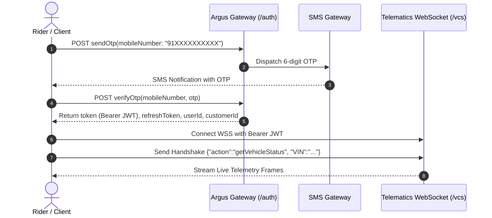

# Complete Oben Electric API & Telematics Architecture Guide

This comprehensive reference documents the entire API surface of the Oben Electric ecosystem, synthesized from the decompiled mobile client (`Oben Electric.apk`) and the local dashboard backend (`rorr-telemetrics-backend`).

---

## 1. Network & Gateway Architecture

| Service / Interface | Protocol | Base URL | Auth Mechanism |
| :--- | :--- | :--- | :--- |
| **API Gateway** | HTTPS | `https://api1.argus.obenelectric.com` | `Authorization: Bearer <JWT>` |
| **Live Telematics (VCS)** | WSS | `wss://api1.argus.obenelectric.com/vcs` | `Authorization: Bearer <JWT>` |
| **OTA / Manifest Service** | HTTPS | `https://mrp.argus.obenelectric.com/manifest` | Client Request Headers |
| **Firebase Cloud Storage** | HTTPS | `oben-argus-prod.firebasestorage.app` | Firebase App Check / Token |
| **Zoho Desk / Appointments** | HTTPS | `https://desk.zoho.in` / `accounts.zoho.in` | `Authorization: Zoho-oauthtoken` |
| **Local Dashboard Server** | HTTP | `http://localhost:5000` | Custom Session / Local Proxy |

---

## 2. Authentication Flow

Authentication is mobile-number-based using an OTP challenge. All requests to the gateway require standard GraphQL JSON envelopes (`operationName`, `query`, `variables`).



### 2.1 Send OTP
- **Endpoint:** `POST https://api1.argus.obenelectric.com/auth`
- **Format:** Indian numbers must be normalized to `91XXXXXXXXXX` (12 digits).

```graphql
mutation SendOtp($mobileNumber: String!) {
  sendOtp(mobileNumber: $mobileNumber) {
    message
    userId
    __typename
  }
}
```

### 2.2 Verify OTP
- **Endpoint:** `POST https://api1.argus.obenelectric.com/auth`

```graphql
mutation VerifyOtp($mobileNumber: String!, $otp: String!) {
  verifyOtp(mobileNumber: $mobileNumber, otp: $otp) {
    token           # Primary Bearer JWT
    refreshToken
    userId
    isRegistered
    customerId
    __typename
  }
}
```

### 2.3 Token Refresh & Session Keepalive
- **Endpoint:** `POST https://api1.argus.obenelectric.com/auth`

```graphql
mutation RefreshToken($refreshToken: String!) {
  refreshToken(refreshToken: $refreshToken) {
    token
    refreshToken
  }
}
```

---

## 3. Real-Time Telematics WebSocket (`/vcs`)

The live dashboard connects to the Vehicle Current Status (VCS) pipeline to receive streaming telemetry (speed, battery SOC, charging status, coordinates).

- **URL:** `wss://api1.argus.obenelectric.com/vcs`
- **Header:** `Authorization: Bearer <token>`

### Connection & Handshake Protocol

```text
Client                                                  Server (Argus VCS)
  |                                                              |
  |--- Connect (wss://api1.argus.obenelectric.com/vcs) --------->|
  |<-- 101 Switching Protocols ----------------------------------|
  |                                                              |
  |--- JSON Handshake: {"action":"getVehicleStatus","VIN":"..."}->|
  |                                                              |
  |<-- Live Stream Messages (JSON Frames) -----------------------|
  |    { "speed": 42, "batterySoc": 88, "latitude": 12.97, ... } |
```

### Handshake Payload
Immediately after the WebSocket `open` event fires, the client must send:

```json
{
  "action": "getVehicleStatus",
  "VIN": "ME4XXXXXXXXXXXXXX"
}
```

### Inbound Telemetry Frame Attributes
- `batterySoc`: Current battery charge percentage (0–100%).
- `speed`: Vehicle ground speed (km/h).
- `range`: Estimated distance to empty (km).
- `chargingStatus`: Integer/string flag indicating charging state.
- `latitude` / `longitude`: Real-time GPS coordinates.
- `lockStatus`: Electronic ignition / handlebar lock status.
- `safeMode`: Limp / Safe mode status flag.

---

## 4. GraphQL Core Vehicle Operations

### 4.1 Vehicle & Account Details (`GetUserAllDetails`)
Retrieves the user's registered vehicles, hardware identifiers, and cellular package status.
- **Endpoint:** `POST https://api1.argus.obenelectric.com/auth`

```graphql
query GetUserAllDetails($userId: ID!) {
  getUserAllDetails(userId: $userId) {
    userId
    vehicleDetails {
      vehicleId
      VIN
      active
      IMEI
      status
      pkgExpDate        # Data pack / TCU cellular expiration timestamp
    }
  }
}
```

### 4.2 Query Vehicle by IMEI / VIN
- **Endpoint:** `POST https://api1.argus.obenelectric.com/auth`

```graphql
query GetVehicleByIMEI($IMEI: String!) {
  getVehicleByIMEI(IMEI: $IMEI) {
    modelDetails {
      vehicleModelId
      name
    }
  }
}

query GetVehicleCurrentStatus($vin: String!) {
  getVehicleCurrentStatus(vin: $vin) {
    soc
    speed
    distanceToEmpty
    ignitionStatus
    updatedAt
  }
}
```

### 4.3 Geofencing Management
- **Endpoint:** `POST https://api1.argus.obenelectric.com/auth`

```graphql
# List existing fences
query GetGeofences($vehicleId: ID!) {
  getGeofences(vehicleId: $vehicleId) {
    geofenceId
    name
    longitude
    latitude
    radius
    notify {
      entry
      exit
    }
  }
}

# Create a new perimeter
mutation CreateGeofence(
  $name: String!
  $longitude: Float!
  $latitude: Float!
  $radius: Int!
  $entry: Boolean
  $exit: Boolean
  $vehicleId: ID!
) {
  createGeofence(
    name: $name
    longitude: $longitude
    latitude: $latitude
    radius: $radius
    entry: $entry
    exit: $exit
    vehicleId: $vehicleId
  ) {
    geofenceId
    name
  }
}

# Delete a perimeter
mutation DeleteGeofence($vehicleId: ID!, $geofenceId: ID!) {
  deleteGeofence(vehicleId: $vehicleId, geofenceId: $geofenceId) {
    success
  }
}
```

### 4.4 Alerts & Safety (`/alert`)
- **Endpoint:** `POST https://api1.argus.obenelectric.com/alert`

```graphql
query getAlertLogsByImei($filterQuery: AlertFilterInput!) {
  getAlertLogsByImei(filterQuery: $filterQuery) {
    alertId
    alertType       # Theft, Fall/Crash, Low Battery, Geofence breach
    severity
    timestamp
    location {
      lat
      lng
    }
    resolved
  }
}

mutation ResolveAllAlertLogsV2($imei: String!, $resolveComment: String!) {
  resolveAllAlertLogsV2(imei: $imei, resolveComment: $resolveComment) {
    success
  }
}
```

---

## 5. Analytics & Trip History (REST APIs)

Historical ride logs and trip telemetry use standard REST routes under `/analytics-service/`:

### 5.1 Filtered Trips List
- **Endpoint:** `GET https://api1.argus.obenelectric.com/analytics-service/trips/getAllTripsbyFilter`
- **Query Parameters:**
  - `IMEI`: Bike's TCU IMEI string
  - `fromDate`: UTC timestamp (e.g., `2026-08-01T18:30:00.000Z`)
  - `toDate`: UTC timestamp
  - `page`: `1`
  - `pageSize`: `50`

### 5.2 Single User Trip Distance & Metrics
- **Endpoint:** `GET https://api1.argus.obenelectric.com/analytics-service/trips/getVehicleTripsOfSingleUser`
- **Query Parameters:** `IMEI`, `fromDate`, `toDate`
- **Response Attributes:**
  - Total distance traveled (km)
  - Average & maximum speed
  - SOC consumed (percentage points)
  - Estimated carbon offset ($CO_2$ saved)

### 5.3 Trip Route GPS Breadcrumbs
- **Endpoint:** `GET https://api1.argus.obenelectric.com/analytics-service/trips/getTripVehiclePath`
- **Query Parameters:** `tripId`
- **Response:** Array of `[latitude, longitude, timestamp, speed]` coordinates forming the polyline.

---

## 6. External Service Gateways

### 6.1 Google Maps Proxy (`/external-api`)
To protect native Google Maps API keys from client exposure, the app routes geocoding and direction requests through the Argus backend:
- **Endpoint:** `POST https://api1.argus.obenelectric.com/external-api`
- **Headers:** `Authorization: Bearer <token>`

```json
{
  "service": "GOOGLE_MAP",
  "url": "https://maps.googleapis.com/maps/api/geocode/json?latlng=12.9716,77.5946",
  "requestMethod": "GET",
  "body": {}
}
```

### 6.2 Zoho CRM & Service Appointments
- **OAuth Endpoint:** `POST https://accounts.zoho.in/oauth/v2/token`
- **Desk API:** `GET https://desk.zoho.in/api/v1/tickets`
- **Appointments API:** `POST /api/zoho/createAppointment`
- Handles test ride requests, showroom test drives, and scheduled maintenance slots.

---

## 7. Local Hardware Interface: Bluetooth Low Energy (BLE)

For local, proximity-based control, the phone communicates directly with the motorcycle cluster using `react-native-ble-manager` and custom native Kotlin services (`com.nativeargusmodules`):

```text
+-----------------------------------------------------------+
|                     Android Framework                     |
|                                                           |
| [MediaSessionManager]       [Telephony / SMS Broadcasts]  |
|         |                                 |               |
|         v                                 v               |
| [MusicListenerService]        [NativeArgusModulesSpec]    |
|         |                                 |               |
|         +----------------+----------------+               |
|                          |                                |
|                          v                                |
|             [BleBroadcastReceiver (BLE)]                  |
+--------------------------+--------------------------------+
                           | Bluetooth LE Radio (GATT)
                           v
            +------------------------------+
            |  Oben Motorcycle Dashboard   |
            | - Song Title & Artist Display|
            | - Incoming Call & SMS Alerts |
            | - Safe Mode Recovery ECU     |
            +------------------------------+
```

### Native Service Highlights
1. **Background Discovery:** `BleBroadcastReceiver` and `BLEDeviceFoundReceiver` listen for BLE advertisements from the bike to pair without opening the phone.
2. **Media Mirroring:** `MusicListenerService` streams metadata (title, artist, playback state) to the handlebar display.
3. **Notification Mirroring:** `startSMSListening` forwards caller ID and incoming SMS previews to the digital instrument cluster.
4. **ECU Safe Mode Reset:** A dedicated Bluetooth command clears safe mode limp states directly through `resetSafeMode.tsx`.

---

## 8. Dashboard Implementation Reference

### Frontend Services (`rorr-telemetrics`)
- `src/services/authApi.js`: Handles session authentication, OTP challenges, and token renewal.
- `src/services/vehicleApi.js`: Requests vehicle telemetry, trip summaries, geocoding, and geofences.
- `src/services/antBmsBle.js`: Handles ANT BMS Web Bluetooth GATT telemetry stream (cell voltages, current, pack health).
- `src/services/documentStorage.js`: Client-side IndexedDB wallet for vehicle documents (RC, Insurance, PUC, DL).

### Backend Proxy Services (`rorr-telemetrics-backend`)
- `services/telematics.js`: Manages the resilient upstream WebSocket connection to `wss://api1.argus.obenelectric.com/vcs`, sends `getVehicleStatus` handshake, and broadcasts telemetry to frontend clients.
- `routes/vehicle.js`: Proxies REST trip metrics, GraphQL alert logs, and geofence operations to Argus cloud with automatic token renewal.
