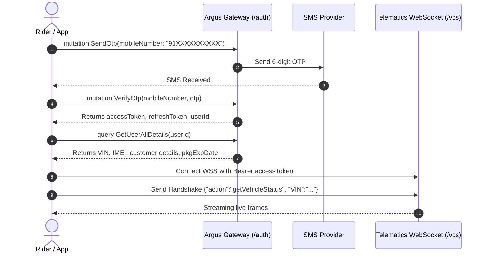

# Complete Oben Electric API & Telematics Architecture Guide

This comprehensive reference documents the entire API surface of the Oben Electric ecosystem, synthesized directly from the disassembled mobile client (`Oben Electric.apk` Hermes Bytecode bundle), manifests, and our local dashboard backend (`rorr-telemetrics-backend`).

---

## 0. Why We Need a Local Backend Proxy (Architecture FAQ)

### Question:
> *"If the backend of Oben Rorr always remains active, why don't we call their backend directly from the frontend instead of running our own backend?"*

### Answer:
While Oben’s cloud servers (`api1.argus.obenelectric.com`) are always active, a standard web browser **cannot** connect to them directly due to fundamental browser security models and protocol constraints:

1. **Browser CORS (Cross-Origin Resource Sharing) Blocking:**
   - The official Oben Android app is a native mobile application (React Native / OkHttp). Native mobile operating systems do not enforce browser CORS policies.
   - When our dashboard runs in a web browser (Chrome, Safari, Firefox) on `http://localhost:5173` or `https://my-dashboard.com`, any direct `fetch()` or `axios` call to `https://api1.argus.obenelectric.com` triggers an HTTP `OPTIONS` preflight request.
   - Because Oben's servers do not return permissive `Access-Control-Allow-Origin: *` headers for arbitrary third-party web domains, the browser halts the request instantly with a CORS error before any data reaches JavaScript.
   - Our Node.js backend runs outside the browser and has no CORS restrictions when interacting with Oben's gateway.

2. **WebSocket Header Authentication Restriction in Browsers:**
   - Oben's real-time VCS stream (`wss://api1.argus.obenelectric.com/vcs`) requires an HTTP handshake header: `Authorization: Bearer <accessToken>`.
   - The browser standard JavaScript `new WebSocket(url)` API **strictly forbids passing custom HTTP headers** during the WebSocket connection handshake.
   - Our Node.js backend uses the `ws` engine, which easily attaches custom authorization headers, performs the initial handshake, and multiplexes telemetry to the frontend via a standard browser-compatible WebSocket or SSE.

3. **Single VCS Socket Multiplexing & Connection Keep-Alive:**
   - The Oben TCU (Telematics Control Unit) pipeline only streams live packets to **one active VCS socket per VIN**.
   - If multiple browser tabs or devices open simultaneously against Oben's gateway, they would constantly disconnect and kick each other off.
   - Our backend maintains a single, resilient upstream WebSocket connection with exponential backoff and broadcasts the incoming telemetry to any number of connected frontend clients.

4. **Silent Token Refresh & Secret Isolation:**
   - JWT access tokens expire periodically.
   - The local backend safely manages the `refreshToken`, automatically renegotiates access tokens before expiry, and prevents token race conditions without exposing sensitive refresh credentials or forcing the rider to re-enter OTPs repeatedly.

---

## 1. Network & Gateway Architecture

| Service / Interface | Protocol | Base URL | Auth Mechanism | Purpose |
| :--- | :--- | :--- | :--- | :--- |
| **API Gateway** | HTTPS | `https://api1.argus.obenelectric.com` | `Authorization: Bearer <JWT>` | GraphQL core operations, alerts, geofencing |
| **Live Telematics (VCS)** | WSS | `wss://api1.argus.obenelectric.com/vcs` | `Authorization: Bearer <JWT>` | Live streaming telemetry (speed, SOC, GPS) |
| **OTA / Manifest Service** | HTTPS | `https://mrp.argus.obenelectric.com/manifest` | Client Request Headers | Cluster firmware & TCU updates |
| **Firebase Cloud Storage** | HTTPS | `oben-argus-prod.firebasestorage.app` | Firebase App Check / Token | User profile & uploaded KYC assets |
| **Google Maps Gateway Proxy** | HTTPS | `POST /external-api` | `Authorization: Bearer <JWT>` | Directions (`API_GOOGLE_MAP_ROUTES`) & Geocoding |
| **Zoho Desk India** | HTTPS | `https://desk.zoho.in` / `accounts.zoho.in` | `Authorization: Zoho-oauthtoken` | Customer support, tickets, and roadside assistance |
| **Local Proxy Server** | HTTP / WS | `http://localhost:5000` | Custom Local Session | CORS bypass, socket multiplexer, ANT BMS sync |

---

## 2. Authentication & Profile Management (GraphQL)

Authentication is mobile-number-based with an OTP challenge. All requests require standard GraphQL envelopes (`operationName`, `query`, `variables`).



### 2.1 Send OTP
Dispatches an SMS OTP to the customer's phone number. Format: Indian numbers normalized to `91XXXXXXXXXX`.
- **Endpoint:** `POST https://api1.argus.obenelectric.com/auth`

```graphql
mutation SendOtp($mobileNumber: String!) {
  sendOtp(mobileNumber: $mobileNumber) {
    message
    userId
  }
}
```

### 2.2 Verify OTP
Submits the received OTP code and returns the JWT Bearer token.
- **Endpoint:** `POST https://api1.argus.obenelectric.com/auth`

```graphql
mutation VerifyOtp($mobileNumber: String!, $otp: String!) {
  verifyOtp(mobileNumber: $mobileNumber, otp: $otp) {
    accessToken
  }
}
```

### 2.3 Resend OTP
Requests re-transmission of the OTP.
```graphql
mutation ResendOtp($mobileNumber: String!) {
  resendOtp(mobileNumber: $mobileNumber) {
    message
  }
}
```

### 2.4 Authenticate (Session Validation)
Validates existing session tokens upon application launch.
```graphql
mutation Authenticate($token: String!) {
  authenticate(token: $token) {
    message
    userId
    name
    role
  }
}
```

### 2.5 Refresh Token
Renews an expired access token using the stored refresh token.
```graphql
mutation RefreshToken($refreshToken: String!) {
  refreshToken(refreshToken: $refreshToken) {
    accessToken
  }
}
```

### 2.6 Logout
Terminates the active session.
```graphql
mutation Logout {
  logout {
    message
  }
}
```

### 2.7 Customer Engagement Record
Tracks customer engagement and login streaks.
```graphql
mutation CreateCustomerDailyLoginRecord($userId: ID!) {
  createCustomerDailyLoginRecord(userId: $userId)
}
```

### 2.8 Get User & Vehicle Details (`GetUserAllDetails`)
Pulls user identity, paired vehicles, hardware identifiers, and cellular plan status.
- **Endpoint:** `POST https://api1.argus.obenelectric.com/auth`

```graphql
query GetUserAllDetails($userId: ID!) {
  getUserAllDetails(userId: $userId) {
    userId
    firstName
    lastName
    email
    mobileNumber
    vehicleDetails {
      vehicleId
      VIN
      active
      IMEI
      MACAddress
    }
    status
    customerDetails {
      customerId
      profileImage
      fcmTokenList
      insuranceExpDate
      rtoRegistrationName
      registrationNumber
      pkgExpDate        # 4G TCU cellular package expiration
      emergencyContacts {
        name
        phoneNumber
      }
    }
  }
}
```

### 2.9 Update Customer Profile
```graphql
mutation UpdateCustomer(
  $firstName: String
  $lastName: String
  $profileImage: String
  $customerId: ID!
  $registrationNumber: String
  $rtoRegistrationName: String
  $insuranceExpDate: String
  $emergencyContacts: [EmergencyContactInput]
) {
  updateCustomer(
    input: {
      customerId: $customerId
      firstName: $firstName
      lastName: $lastName
      profileImage: $profileImage
      registrationNumber: $registrationNumber
      rtoRegistrationName: $rtoRegistrationName
      insuranceExpDate: $insuranceExpDate
      emergencyContacts: $emergencyContacts
    }
  ) {
    customerId
  }
}
```

---

## 3. Vehicle Status & Safe Mode Control

### 3.1 Get Vehicle Current Status (Cloud Snapshot)
Pulls immediate vehicle parameters from the cloud cache.
- **Endpoint:** `POST https://api1.argus.obenelectric.com/auth`

```graphql
query GetVehicleCurrentStatus($vin: String!) {
  getVehicleCurrentStatus(VIN: $vin) {
    ignitionStatus
    chargerConnected
    SOC                         # State of Charge (0-100%)
    latitude
    longitude
    estimatedDistanceRemaining  # Range in km
    fullChargeTime
    mode                        # Ride Mode (Eco, City, Havoc)
  }
}
```

### 3.2 Query Vehicle by IMEI / Hardware Flags
```graphql
query GetVehicleByIMEI($IMEI: String!) {
  getVehicleByIMEI(IMEI: $IMEI) {
    vehicleType
    enableResetSafeModeCapability
    modelDetails {
      vehicleModelId
      name
    }
  }
}
```

### 3.3 Safe Mode Reset Capability Flag
Updates ECU capability flags during a limp mode recovery routine.
```graphql
mutation UpdateVehicleDisableResetSafeModeCapability($VIN: String!) {
  updateVehicleDisableResetSafeModeCapability(VIN: $VIN)
}
```

---

## 4. Real-Time Telematics WebSocket (`/vcs`)

The live dashboard connects to the Vehicle Current Status (VCS) pipeline to receive streaming telemetry frames.

- **URL:** `wss://api1.argus.obenelectric.com/vcs`
- **Header:** `Authorization: Bearer <accessToken>`

### Subscription Handshake
Immediately after WebSocket connection opens:
```json
{
  "action": "getVehicleStatus",
  "VIN": "ME4XXXXXXXXXXXXXX"
}
```

### Stream Frame Attributes
- `batterySoc`: Current battery charge percentage (0–100%).
- `speed`: Vehicle ground speed (km/h).
- `range`: Estimated distance to empty (km).
- `chargingStatus`: Flag indicating charger connection state.
- `latitude` / `longitude`: Real-time GPS coordinates.
- `lockStatus`: Electronic ignition / handlebar lock status.
- `safeMode`: Limp/Safe mode status flag.

---

## 5. Geofencing APIs

### 5.1 Get Geofences
```graphql
query GetGeofences($vehicleId: ID!) {
  getGeofences(vehicleId: $vehicleId) {
    geofenceId
    name
    longitude
    latitude
    radius
    notify {
      entry
      exit
    }
  }
}
```

### 5.2 Create Geofence
```graphql
mutation CreateGeofence(
  $name: String!
  $longitude: Float!
  $latitude: Float!
  $radius: Int!
  $entry: Boolean
  $exit: Boolean
  $vehicleId: ID!
) {
  createGeofence(
    vehicleId: $vehicleId
    geofenceDetails: {
      name: $name
      longitude: $longitude
      latitude: $latitude
      radius: $radius
      notify: { exit: $exit, entry: $entry }
    }
  ) {
    vehicleId
    geofence {
      geofenceId
      name
      longitude
      latitude
      radius
      notify {
        entry
        exit
      }
    }
  }
}
```

### 5.3 Update Geofence
```graphql
mutation UpdateGeofence(
  $name: String
  $longitude: Float
  $latitude: Float
  $radius: Int
  $entry: Boolean
  $exit: Boolean
  $geofenceId: ID!
  $vehicleId: ID!
) {
  updateGeofence(
    vehicleId: $vehicleId
    geofenceDetails: {
      geofenceId: $geofenceId
      name: $name
      longitude: $longitude
      latitude: $latitude
      radius: $radius
      notify: { exit: $exit, entry: $entry }
    }
  ) {
    vehicleId
  }
}
```

### 5.4 Delete Geofence
```graphql
mutation DeleteGeofence($vehicleId: ID!, $geofenceId: ID!) {
  deleteGeofence(vehicleId: $vehicleId, geofenceId: $geofenceId) {
    vehicleId
  }
}
```

---

## 6. Safety, Fall Detection & Alerts

### 6.1 Get Alert Logs by IMEI
- **Endpoint:** `POST https://api1.argus.obenelectric.com/alert`

```graphql
query GetAlertLogsByImei(
  $page: Int
  $pageSize: Int
  $IMEI: String!
  $severity: SeverityEnum
  $subType: SubAlertType
) {
  getAlertLogsByImei(
    filterQuery: {
      page: $page
      pageSize: $pageSize
      IMEI: $IMEI
      severity: $severity
      subType: $subType
      notificationFor: Customer
      channel: APP
    }
  ) {
    totalCount
    totalPages
    currentPage
    hasPrev
    hasNext
    data {
      packetId
      subType
      severity
      commsStatus
      title
      content
      createdAt
    }
  }
}
```

### 6.2 Dismiss / Resolve All Alerts
```graphql
mutation ResolveAllAlertLogsV2($imei: String!, $resolveComment: String!) {
  resolveAllAlertLogsV2(
    IMEI: $imei
    resolveComment: $resolveComment
    channel: APP
  ) {
    status
  }
}
```

### 6.3 Fall Detection Countdown & SOS Dispatch
```graphql
query SendSosFallDetection($jobId: String!) {
  sendSosFallDetection(jobId: $jobId)
}

query StopFallDetectionNotificationTimer($jobId: String!) {
  stopFallDetectionNotificationTimer(jobId: $jobId)
}
```

---

## 7. Analytics & Trip History (REST APIs)

### 7.1 Filtered Trips List
- **Endpoint:** `GET /analytics-service/trips/getAllTripsbyFilter?IMEI={imei}&fromDate={from}&toDate={to}&page=1&pageSize=50`
- **Headers:** `Authorization: Bearer <accessToken>`

### 7.2 Single User Trip Distance & Metrics
- **Endpoint:** `GET /analytics-service/trips/getVehicleTripsOfSingleUser?IMEI={imei}&fromDate={from}&toDate={to}`
- **Response:** Distance (km), average speed, top speed, SOC consumed, carbon saved ($CO_2$).

### 7.3 Trip Route GPS Breadcrumbs
- **Endpoint:** `GET /analytics-service/trips/getTripVehiclePath?tripId={id}`
- **Response:** Coordinate array of `[lat, lng, timestamp, speed]` forming the route polyline.

### 7.4 Today's Distance
- **Endpoint:** `GET /analytics-service/trips/getTodayTravelledTripsDistance?IMEI={imei}`

---

## 8. Value-Added Services (VAS), Gamification & KYC

### 8.1 4G Cellular Data Pack Renewals (TCU Subscription)
- `GET /shopping/getVasList`: Catalog of available 4G cellular data pack renewals and extended telematics plans.
- `POST /register_customer_vas_argus`: Initiates order checkout for TCU data connectivity plans.

### 8.2 Gamification & Rewards ("Oben Coins")
- `query GetTotalObenCoinsV2($mobileNumber: String!)`: Fetches coin balance, conversion rates to INR.
- `query GetEarnedCoinsHistory($userId: String!, $filterQuery: FilterInput!)`: Lists historical coin earnings and ride milestones.
- `query GetCoinsAndAmountToCharge`: Calculates discounts when redeeming coins during checkout.
- `query GetReferralLink($userId: ID!)`: Generates referral invite URL.

### 8.3 Facilities & KYC Documents
- `GetServiceCentre`: Locates authorized service centers with address, coordinates, and Point of Contact (POC).
- `GetShowroom`: Locates dealerships and experience centers.
- `GetNearestRegion($latitude: Float!, $longitude: Float!)`: Translates GPS coordinates into service regions and pincodes.
- `GetCustomerValidDocumentList`: Acceptable document types for registration/insurance.
- `CreateKycDocument` / `UpdateKycDocument` / `DeleteKycDocument`: Manages cloud-synced KYC records.

---

## 9. External Service Gateways & Support

### 9.1 Google Maps Gateway Proxy (`POST /external-api`)
To protect native Google Maps API keys from client exposure, turn-by-turn routes (`API_GOOGLE_MAP_ROUTES`) and reverse geocoding (`API_GOOGLE_GEO_CODE`) are relayed through the Argus gateway:

```json
{
  "service": "GOOGLE_MAP",
  "url": "https://maps.googleapis.com/maps/api/geocode/json?latlng=12.9716,77.5946",
  "requestMethod": "GET",
  "body": {}
}
```

### 9.2 Zoho Desk & Support Services
- `zohoAuth/getAccessToken`: Exchanges credentials for temporary Zoho OAuth tokens.
- `zohoTickets/getZohoTickets`: Retrieves support tickets opened by the user.
- `zohoTickets/addZohoTickets`: Submits a new support or roadside assistance ticket.
- `serviceAppointment/getZohoCustomers`: Fetches customer records for scheduling maintenance slots.

---

## 10. Local Hardware BLE Architecture

```text
+-----------------------------------------------------------+
|                     Android Framework                     |
|                                                           |
| [MediaSessionManager]       [Telephony / SMS Broadcasts]  |
|         |                                 |               |
|         v                                 v               |
| [MusicListenerService]        [NativeArgusModulesSpec]    |
|         |                                 |               |
|         +----------------+----------------+               |
|                          |                                |
|                          v                                |
|             [BleBroadcastReceiver (BLE)]                  |
+--------------------------+--------------------------------+
                           | Bluetooth LE Radio (GATT)
                           v
            +------------------------------+
            |  Oben Motorcycle Dashboard   |
            | - Song Title & Artist Display|
            | - Incoming Call & SMS Alerts |
            | - Safe Mode Recovery ECU     |
            +------------------------------+
```

1. **Background Discovery:** `BleBroadcastReceiver` and `BLEDeviceFoundReceiver` listen for BLE advertisements from the bike to pair without opening the phone.
2. **Media Mirroring:** `MusicListenerService` streams metadata (title, artist, playback state) to the handlebar display.
3. **Notification Mirroring:** `startSMSListening` forwards caller ID and incoming SMS previews to the digital instrument cluster.
4. **ECU Safe Mode Reset:** A dedicated Bluetooth command clears safe mode limp states directly through `resetSafeMode.tsx`.
